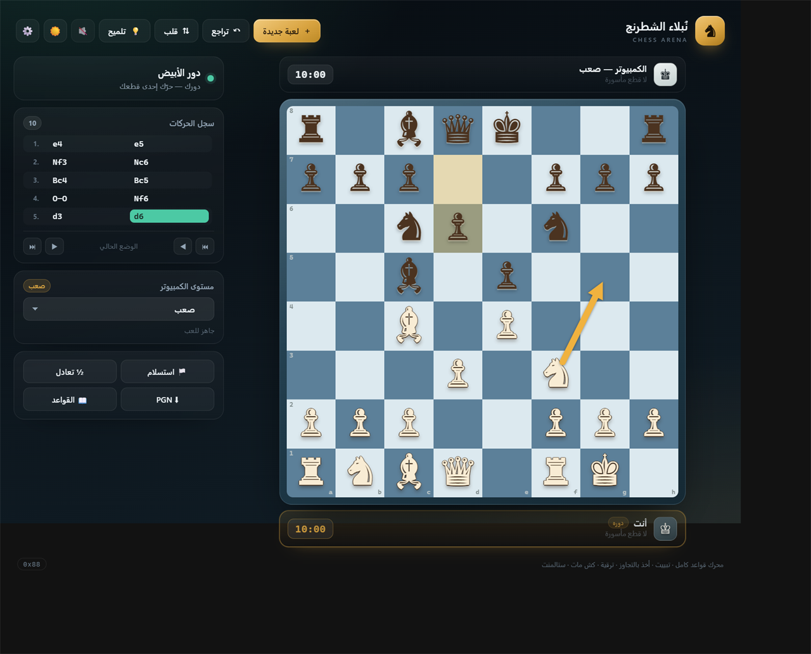

# نُبلاء الشطرنج — Chess Arena ♞

تطبيق شطرنج كامل يعمل في المتصفح، بواجهة عربية احترافية. العب ضد صديق على نفس الجهاز، أو ضد الكمبيوتر بخمسة مستويات، مع محرك قواعد دقيق وساعة وستة تصاميم للرقعة وأربعة تصاميم للقطع وأسهم تحليل وحركات مسبقة، وحفظ تلقائي للمباراة.

ومن الشريط العلوي يمكنك الانتقال إلى قسم **ألعاب الطاولة** — عشر ألعاب محلية كاملة بقواعد عربية مفصّلة، من مونوبولي وكاتان إلى سكرابل وطاولة الزهر. التفاصيل في [`board-games/README.md`](board-games/README.md).



<sub>لقطة من الواجهة على سطح المكتب — ولقطة الهاتف في `preview-mobile.png`.</sub>

---

## التشغيل

- **الأسهل:** افتح `index.html` مباشرة بنقرة مزدوجة.
- **الأفضل (لتفعيل خيط البحث المستقل):** شغّل خادمًا محليًا من داخل مجلد المشروع:

```bash
# Python
python -m http.server 8000

# أو Node.js
npx serve .
```

ثم افتح: `http://localhost:8000/`

> عند فتح الملف مباشرة (`file://`) يعمل التطبيق بالكامل، لكن بحث الكمبيوتر يُنفَّذ في الخيط الرئيسي بدل Web Worker. عبر الخادم المحلي يعمل البحث في خيط منفصل فتبقى الواجهة سلسة تمامًا.

---

## المزايا

### اللعب
- **لاعبان على نفس الجهاز** مع ساعة اختيارية.
- **ضد الكمبيوتر** بخمسة مستويات: مبتدئ، سهل، متوسط، صعب، خبير.
- اختيار لونك: الأبيض، الأسود، أو عشوائي (مع قلب اللوحة تلقائيًا).
- السحب والإفلات، أو النقر على القطعة ثم المربع الهدف.
- نقاط الحركات المتاحة، وحلقة حمراء للأخذ، وتظليل الحركة الأخيرة، وإطار أحمر للملك المكشوف.
- **حركات مسبقة (Premove):** سجّل حركتك أثناء تفكير الكمبيوتر لتُنفَّذ فور ردّه.
- نافذة ترقية بيدق إلى وزير/قلعة/فيل/حصان.
- تلميح لحركة مقترحة، وتراجع (حركتان في وضع الكمبيوتر)، وقلب اللوحة.
- ساعة مباراة: بدون، 3، 5، 10، 15، 30 دقيقة — مع تحذير بصري عند الدقيقة الأخيرة واحتساب انتهاء الوقت.

### القواعد الكاملة
- كل حركات القطع، التبييت القصير والطويل بشروطه، والأخذ بالتجاوز.
- منع أي حركة تترك الملك في كش.
- كش، كش مات، ستالمنت.
- قاعدة الخمسين حركة، وتكرار الوضع ثلاث مرات، وتعادل المواد غير الكافية.
- الاستسلام، وعرض التعادل (يقبله الكمبيوتر حسب تقييمه للموقف).

### السجل والتحليل
- سجل حركات بترميز SAN مع ترقيم الأدوار.
- التنقل في السجل وإعادة عرض أي وضع سابق (وضع المراجعة).
- عدّاد حركات ومؤشر «دوره» لكل لاعب.
- القطع المأسورة وفارق المواد لكل طرف.
- إحصاءات محرك الكمبيوتر: العمق، عدد العقد، والزمن بالميلي ثانية.

### الرقعة والقطع والأسهم والحركة المسبقة
- **زر الإعدادات ⚙️** في الشريط العلوي يجمع تصميم الرقعة وتصميم القطع وأدوات التحليل في نافذة واحدة.
- **ستة تصاميم للرقعة:** كلاسيكي، خشبي، زمردي، محيطي، رخامي، جمشت — مستقلة عن مظهر الواجهة (داكن/فاتح)، ويُحفظ اختيارك.
- **أربعة تصاميم للقطع:** كلاسيكي، عاجي، خطّي، مسطّح — لكل تصميم شكل وألوان وخط مميّزة، ويُحفظ اختيارك ويُطبّق على الرقعة والقطع المأسورة ونافذة الترقية.
- **أسهم التحليل:** اسحب بالزر الأيمن لرسم سهم، أو انقر بالزر الأيمن لوضع علامة على مربع (وإزالتها بالتكرار).
- **وضع الأسهم للمس:** زر في نافذة الإعدادات يجعل السحب بإصبع واحد يرسم سهمًا بدل تحريك القطعة.
- يمكن رسم عدة أسهم وعلامات معًا، ومسحها كلها بزر واحد، وتُمسح تلقائيًا عند تغيّر الوضع.
- **الحركة المسبقة:** أثناء دور الكمبيوتر انقر قطعتك ثم المربع الهدف؛ تُنفَّذ الحركة تلقائيًا إن أصبحت قانونية بعد ردّه، وإلا تُلغى مع تنبيه. الترقية فيها إلى وزير تلقائيًا، ويمكن الإلغاء من الشريط أو بمفتاح `Esc`.

### الواجهة والتجربة
- تصميم داكن احترافي مع نسخة فاتحة، وتبديل فوري.
- مؤثرات صوتية للحركة والأخذ والكش والكش مات (قابلة للإيقاف).
- حفظ تلقائي للمباراة والساعة والإعدادات في `localStorage`، واستئناف تلقائي عند العودة.
- تصدير المباراة بصيغة **PGN**.
- اختصارات لوحة مفاتيح، وإتاحة (ARIA) وأدوار `dialog`/`status`.
- تخطيط متجاوب يعمل حتى عرض 360 بكسل دون تمرير أفقي.

---

## طريقة اللعب

| الإجراء | الطريقة |
| --- | --- |
| تحريك قطعة | اسحبها إلى المربع الهدف، أو انقر عليها ثم انقر على الهدف |
| إلغاء التحديد | انقر على القطعة نفسها أو على مربع فارغ |
| لعبة جديدة | زر «لعبة جديدة» أو المفتاح `N` |
| تراجع | زر «تراجع» أو المفتاح `U` |
| قلب اللوحة | زر «قلب» أو المفتاح `F` |
| تلميح | زر «تلميح» أو المفتاح `H` |
| رسم سهم | اسحب بالزر الأيمن من مربع إلى آخر (أو بإصبع في وضع الأسهم) |
| علامة على مربع | انقر بالزر الأيمن على المربع، أو انقر بإصبع في وضع الأسهم |
| تبديل وضع الأسهم | زر «وضع الأسهم» في الإعدادات ⚙️ أو المفتاح `A` |
| مسح الأسهم والعلامات | زر «مسح الرسومات» في الإعدادات ⚙️ أو المفتاح `C` |
| حركة مسبقة | انقر قطعتك ثم الهدف أثناء دور الكمبيوتر |
| إلغاء الحركة المسبقة | زر «إلغاء» في شريطها أو `Esc` |
| تغيير تصميم الرقعة أو القطع | افتح الإعدادات ⚙️ واختر التصميم المناسب |
| التنقل في السجل | `←` و `→` أو أزرار شريط المراجعة |
| العودة للوضع الحالي | `Esc` |
| إغلاق أي نافذة | `Esc` |

---

## مستويات الكمبيوتر

| المستوى | عمق البحث | حد الزمن | السلوك |
| --- | --- | --- | --- |
| مبتدئ | 1 | 250 م.ث | عشوائية عالية وأخطاء متكررة |
| سهل | 2 | 450 م.ث | أخطاء ملحوظة |
| متوسط | 3 | 1000 م.ث | لعب متوازن |
| صعب | 4 | 2200 م.ث | بحث أعمق دون أخطاء متعمدة |
| خبير | 5 | 4000 م.ث | أقوى مستوى |

> الأزمنة تقديرية وتعتمد على سرعة جهازك؛ يتوقف البحث عند بلوغ العمق المطلوب أو انتهاء الوقت.

---

## بنية المشروع

```
chess/
├── index.html          # الهيكل والواجهة والنوافذ
├── styles.css          # نظام التصميم وتصاميم الرقعة والقطع والأسهم والتجاوب
├── engine.js           # محرك القواعد (0x88) — يعمل في المتصفح وNode
├── ai.js               # التقييم والبحث (Negamax + Alpha-Beta + Quiescence)
├── ai-worker.js        # تشغيل البحث في Web Worker
├── app.js              # منطق الواجهة واللعبة والساعة والحفظ والأسهم والحركة المسبقة
├── board-games/        # قسم ألعاب الطاولة العشر (تطبيق فرعي مستقل)
│   ├── index.html
│   ├── css/
│   ├── js/
│   └── README.md
├── tests/
│   ├── engine.test.js  # اختبارات المحرك وperft
│   └── viewport.html   # أداة قياس التخطيط المتجاوب (اختيارية)
└── README.md
```

### المحرك (`engine.js`)
- تمثيل **0x88** للرقعة مع إنشاء/إلغاء الحركات (make/unmake).
- توليد حركات قانونية كامل، وترميز SAN، واستيراد/تصدير FEN.
- دوال مساعدة: `status` (نتيجة اللعبة)، `insufficientMaterial`، `positionKey`، `perft`.
- يعمل كسكربت متصفح (`window.Chess`) وكوحدة CommonJS للاختبار.

### الذكاء الاصطناعي (`ai.js`)
- بحث **Negamax** مع **Alpha-Beta** وتعميق متكرر.
- بحث الهدوء (Quiescence) لتجنب تقييم أوضاع غير مستقرة.
- تقييم: مادة، جداول مواقع للقطع، بنية البيادق، زوج الفيلة، القلعة على عمود مفتوح، درع الملك.
- ترتيب الحركات بأسلوب **MVV-LVA** وتحسينات الترقية.
- تحكم بالمستوى عبر العمق والزمن والعشوائية واحتمال الخطأ.

---

## الاختبارات

```bash
node --test tests/engine.test.js
```

تشمل الاختبارات:

- مقارنة **perft** لستة أوضاع مرجعية معروفة:
  - الوضع الابتدائي: 20 / 400 / 8,902 / 197,281
  - Kiwipete: 48 / 2,039 / 97,862
  - المواضع 3 و4 و5 و6 بالنتائج المرجعية.
- SAN، التبييت، الترقية، الأخذ بالتجاوز.
- كش مات، ستالمنت، تعادل المواد.
- ذهاب وعودة FEN، وعدم ترك الملك في كش.

جميع الاختبارات الـ15 ناجحة.

---

## الحفظ والخصوصية

- لا يوجد أي اتصال بخادم ولا حسابات ولا تتبّع.
- تُخزَّن المباراة والإعدادات محليًا في متصفحك فقط:
  - `chess.arena.game.v1` — المباراة والسجل والساعة.
  - `chess.arena.prefs.v1` — الوضع والمستوى واللون والمظهر وتصميم الرقعة وتصميم القطع والصوت.
- حذف بيانات الموقع من المتصفح يمسح المحفوظات.

---

## ملاحظات وحدود

- اللعب الجماعي عبر الإنترنت غير مضمّن؛ «ضد صديق» تعني لاعبين على نفس الجهاز.
- الساعة محلية وليست معتمدة رسميًا، وتتوقف أثناء إخفاء التبويب.
- عند فتح الملف مباشرة قد يتجمد التطبيق لحظات أثناء بحث «خبير» لأن البحث يجري في الخيط الرئيسي؛ استخدم خادمًا محليًا لتجنب ذلك.
- يعمل على المتصفحات الحديثة (Chrome، Edge، Firefox، Safari) التي تدعم `dialog` و`localStorage` و`ResizeObserver`.

---

صُنع بعناية — استمتع بالمباراة ♟️
